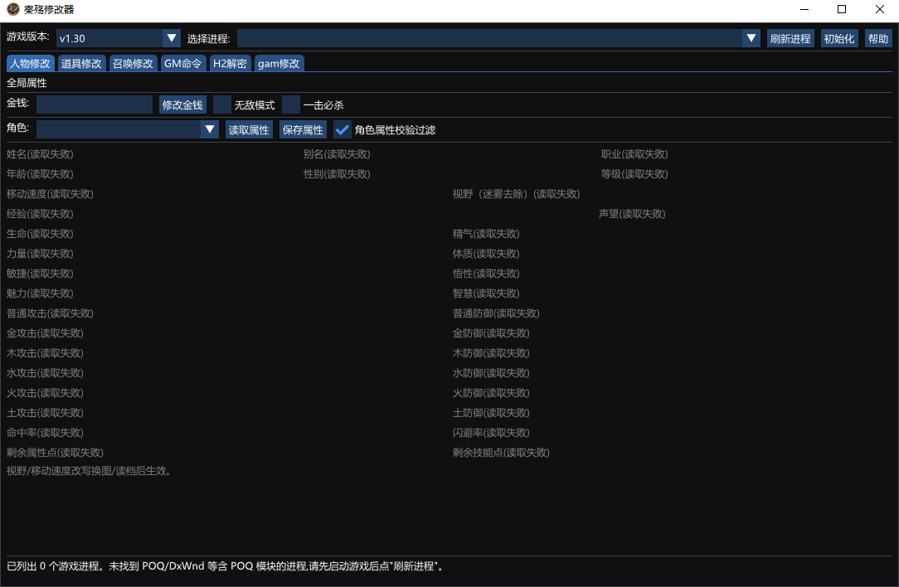

# 秦殇修改器 (PoqEditor) - Dear ImGui 版

[EN](README_EN.md)

秦殇(POQ)游戏内存修改器，基于 **Dear ImGui + Win32 + DirectX11** 实现。
- **单个 exe,零 DLL 依赖**(MSVC /MT 静态运行时,连 VCRUNTIME 都不需要);
- **无控制台窗口**、**无 imgui 自绘标题栏**(用系统标准标题栏,标题与主界面一致,不重复);
- **深色蓝色强调主题**（Dear ImGui Dark）、**中文字体**(运行时加载系统微软雅黑,无需打包字体);
- 体积 ~1-2MB,拷贝即跑。

## 截图



## 运行

1. 启动游戏(POQ.EXE)。
2. 双击 `PoqEditor.exe`(内嵌管理员清单,自动请求 UAC)。
3. 顶部"选择进程"下拉框选 POQ.EXE(自动选中),点"初始化"(未注入则自行 AOB 注入)。
4. 游戏中用鼠标选中箱子中的物品然后放下(读取的是最后选中的物品,不是光标上的物品)。
5. "物品修改"页点"读取属性"载入基础属性与属性列表。
6. 修改基础属性;属性列表可"添加/删除/清空"或"从模板读取"载入 JSON、"另存为"导出。
7. 点"保存属性"写回内存;游戏中把物品扔到地上再捡起使修改生效。
8. 角色修改在"属性修改"页:选好角色点"读取属性",修改后"保存属性",存档再读档查看生效;
   亦可勾选"无敌模式/一击必杀"实时锁定。

## 构建

需要 Windows、MSVC（Visual Studio）、Windows SDK、CMake，以及一份 Dear ImGui 源码。
本仓库不包含 ImGui；请从 [Dear ImGui 官方仓库](https://github.com/ocornut/imgui) 获取源码。
`IMGUI_DIR` 应指向直接包含 `imgui.h` 和 `backends/` 的目录。

| 依赖 | 版本 / 要求 | 用途 |
|------|-------------|------|
| [Dear ImGui](https://github.com/ocornut/imgui) | v1.92.1 | UI 框架；源码由使用者自行提供 |
| CMake | ≥ 3.16（已验证 4.4.2） | 生成构建工程 |
| MSVC / Visual Studio | C++17 兼容工具链（已验证 Visual Studio 18 2026 / MSVC 19.51） | C++ 编译器和链接器 |
| Windows SDK | Direct3D 11、DXGI、D3DCompiler（已验证 10.0.26100.0，未锁定） | 图形与 Windows API |

项目使用 C++17、Win32 与 Direct3D 11；没有其他随仓库分发的第三方库。

```bat
cmake -S . -B build -A x64 -DIMGUI_DIR=C:\path\to\imgui
cmake --build build --config Release
```

若需要指定生成器，例如 Visual Studio：

```bat
cmake -S . -B build -G "Visual Studio 17 2022" -A x64 -DIMGUI_DIR=C:\path\to\imgui
cmake --build build --config Release
```

产出:`build\Release\PoqEditor.exe`(单文件,可直接拷给别人)。

- 可通过 CMake 缓存、命令行 `-DIMGUI_DIR=...` 或 CMake GUI 设置 `IMGUI_DIR`。

### 维护命令(可选)

| 命令 | 说明 |
|------|------|
| `build.bat format` | clang-format + Win32 include 修正 |
| `build.bat tidy` | clang-tidy(需先 cmake 配置) |
| `build.bat check_api` | 校验 `Api*.h` 与 `_api_groups.txt` |
| `build.bat json_rt` | JSON 解析/写出往返自检 |
| `build.bat affix_rt` | GAM 词条回归(需本地语料,见 `affix_rt.local.example.bat`) |

## 项目结构

```text
poqeditor_imgui/
├── CMakeLists.txt          MSVC /MT + Dear ImGui + DX11 + WIN32 子系统
├── build.bat               一键构建 -> build\Release\PoqEditor.exe
├── app.manifest            requireAdministrator + UTF-8 代码页
├── app.rc                  内嵌 manifest + exe 图标
├── poq_multi_3sizes.ico    图标源文件(仅编译时需要)
├── README.md
├── AGENTS.md               贡献与自动化代理说明
├── CLAUDE.md               指向 AGENTS.md 的兼容入口
└── src/
    ├── main.cpp            入口与主循环
    ├── Platform/           Win32 + D3D11 后端
    ├── Core/               静态库 PoqCore(与 AffixRt/JsonRt 共享)
    │   ├── ItemProperty.h       一条非固定属性
    │   ├── ItemData.h/.cpp      属性 ID/颜色/百分比 查表与互转(UTF-8)
    │   ├── OffsetsConfig.h/.cpp 内置默认偏移(不读配置文件,单文件版)
    │   ├── Json.h/.cpp          轻量 JSON DOM(UTF-8),替代 QJson
    │   ├── JsonTemplate.h/.cpp  JSON 模板加载(校验)与导出
    │   └── GameModder.h/.cpp    AOB 注入 + 属性读写核心
    └── Native/
        └── ProcessMemory.h/.cpp Win32 进程内存读写/分配封装
```

## 常见问题

- **初始化报"OpenProcess 失败"**:没以管理员运行,或游戏刚重启(PID 失效,会自动重找一次)。
- **报"未找到模块 EasyRPG116.dll"**:游戏没启动或版本不同,或当前游戏 DLL 与内置偏移不匹配。
- **中文不显示**:确认系统有微软雅黑/黑体/宋体(正常 Windows 都有);字体从系统目录加载。
- **界面缺字/乱码**:所有源文件均为 UTF-8,MSVC 用 `/utf-8` 编译,勿改编码。
