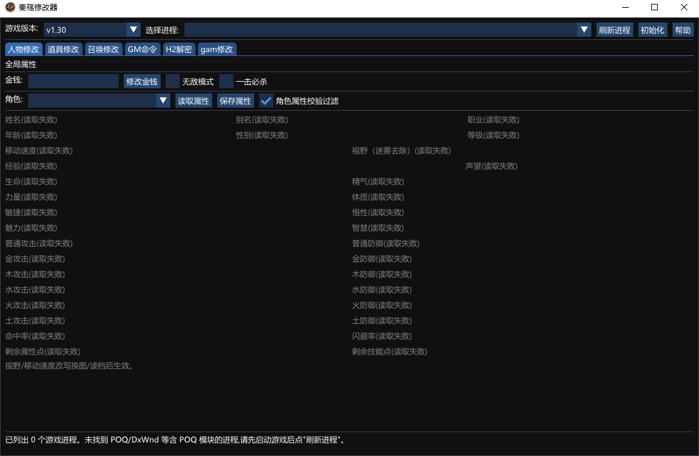

# PoqEditor — Dear ImGui Edition

[CN](README.md)

PoqEditor is a Prince of Qin (POQ) in-memory item editor built with **Dear ImGui,
Win32, and DirectX 11**.

- A single executable with no runtime DLL dependency: the MSVC runtime is linked
  statically.
- No console window and a standard Windows title bar.
- Dear ImGui's Dark theme with blue accents and Chinese system fonts loaded at
  runtime.

## Screenshot



## Running

1. Start the game (`POQ.EXE`).
2. Run `PoqEditor.exe` as administrator.
3. Choose the game process from the process list and select **Initialize**.
4. Select and drop an item in the game, then use the **Item Editor** tab to read,
   edit, and save its properties.

## Building

You need Windows, MSVC (Visual Studio), the Windows SDK, CMake, and a checkout
of Dear ImGui. Dear ImGui is not bundled with this repository; obtain it from
the [official Dear ImGui repository](https://github.com/ocornut/imgui).
`IMGUI_DIR` must point to the directory that directly contains `imgui.h` and
the `backends` directory.

| Dependency | Version / requirement | Purpose |
|------------|-----------------------|---------|
| [Dear ImGui](https://github.com/ocornut/imgui) | v1.92.1 | UI framework; supplied by the developer |
| CMake | >= 3.16 (validated with 4.4.2) | Build generation |
| MSVC / Visual Studio | C++17-compatible toolchain (validated with Visual Studio 18 2026 / MSVC 19.51) | Compiler and linker |
| Windows SDK | Direct3D 11, DXGI, and D3DCompiler (validated with 10.0.26100.0; not pinned) | Graphics and Windows APIs |

The project uses C++17, Win32, and Direct3D 11. No other third-party library is
distributed with this repository.

```bat
cmake -S . -B build -A x64 -DIMGUI_DIR=C:\path\to\imgui
cmake --build build --config Release
```

For an explicit Visual Studio generator:

```bat
cmake -S . -B build -G "Visual Studio 18 2026" -A x64 -DIMGUI_DIR=C:\path\to\imgui
cmake --build build --config Release
```

The output is `build\Release\PoqEditor.exe`.

## Layout

```text
.
├── CMakeLists.txt          CMake build definition
├── assets/                 Documentation images
├── src/
│   ├── Core/               Game data and editor logic
│   ├── Native/             Win32 process-memory wrappers
│   ├── Platform/           Win32 + Direct3D 11 backend
│   └── UI/                 Dear ImGui interface
└── tools/                  Development utilities
```

## Troubleshooting

- **OpenProcess failed:** run as administrator, or refresh the process after the
  game restarts.
- **EasyRPG116.dll was not found:** start the game and verify that the supported
  game version is in use.
- **Chinese text is missing:** ensure a Chinese Windows system font (such as
  Microsoft YaHei) is installed.
